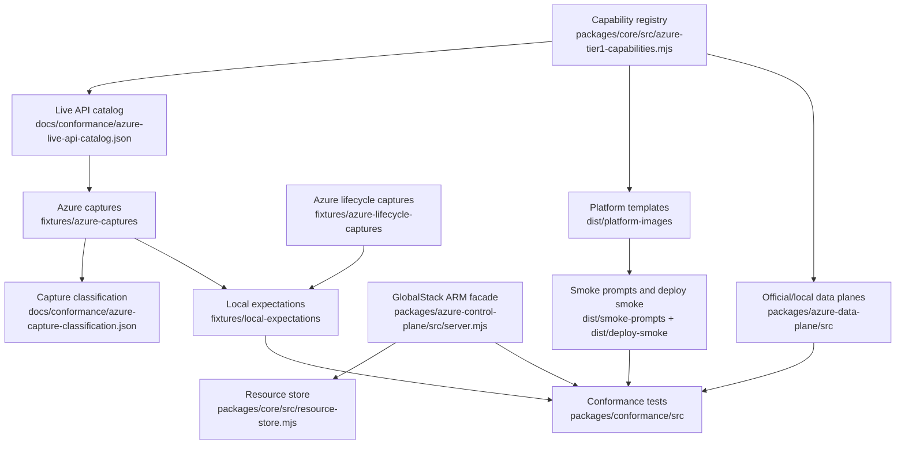

# Repository Map

Generated by: `npm run docs:map`

This file is a navigation aid. It does not replace `docs/START-HERE.md` or `docs/CONFORMANCE-MODEL.md`; those files define the project contract.

## High-Level Flow

## Core Packages

| Area | Files | Responsibility |
|---|---|---|
| Capability registry | `packages/core/src/azure-tier1-capabilities.mjs` | Tier 1/Tier 2 service scope, AWS analogues, Azure resource types, backing engines, known gaps. |
| API catalog | `packages/core/src/azure-live-api-catalog.mjs` | Candidate ARM calls and parameter variance cases for live/local conformance. |
| Hybrid coverage | `packages/core/src/hybrid-coverage.mjs` | Generated support-state model used by docs and emulator endpoints. |
| Resource store | `packages/core/src/resource-store.mjs` | In-memory Azure-shaped resource groups/resources and selected lifecycle state. |
| ARM facade | `packages/azure-control-plane/src/server.mjs` | Local Azure management-plane HTTP surface. Must fail closed for unknown or unproven behavior. |
| Provider validation | `packages/azure-control-plane/src/provider-validation.mjs` | Azure-captured validation responses normalized into local behavior. |
| Data plane adapters | `packages/azure-data-plane/src/*` | Official emulator compose generation and Azurite client checks. |
| Conformance | `packages/conformance/src/*` | Registry, capture, local expectation, lifecycle, and hybrid behavior tests. |

## Generated Artifacts

| Artifact | Source | Meaning |
|---|---|---|
| `dist/platform-images/` | `npm run render` | Docker runner templates for Azure Terraform, OpenTofu, Pulumi, Ansible, Bicep, and ARM JSON. |
| `templates/emulator/Dockerfile` | hand maintained | First-party GlobalStack Azure sidecar image. |
| `docs/localstack-azure/coverage.json` | `npm run fetch:azure-coverage` | Archived third-party coverage snapshot. Historical reference only. |
| `docs/hybrid/azure-hybrid-coverage.json` | `npm run hybrid:render` | Generated local support matrix. |
| `docs/conformance/azure-live-api-catalog.json` | `npm run conformance:catalog` | Candidate live Azure API calls and variance cases. |
| `docs/ARTIFACT-REGISTRY.md` | `npm run docs:artifacts` | File ownership, edit policy, source-of-truth boundaries, and generator commands. |
| `docs/conformance/azure-capture-classification.json` | `npm run conformance:classify` | Classification of real Azure captures by validation depth. |
| `fixtures/local-expectations/*.json` | `npm run conformance:expectations` and `npm run lifecycle:expectations` | Azure-derived expectations replayed against the local ARM facade. |
| `dist/smoke-prompts/` | `npm run smoke:prompts` | Prompt bundles for all platform templates. |
| `dist/deploy-smoke/` | `npm run smoke:deploy` | AI/MLOps, robotics, and GenAI smoke deployment outputs. |

## Registry Size

- Tier 1 capabilities: 15
- Tier 2 capabilities: 15
- Official/local emulator options: 13

## Package Files

- `packages/core/src/azure-live-api-catalog.mjs`
- `packages/core/src/azure-tier1-capabilities.mjs`
- `packages/core/src/hybrid-coverage.mjs`
- `packages/core/src/resource-store.mjs`
- `packages/azure-control-plane/src/provider-validation.mjs`
- `packages/azure-control-plane/src/server.mjs`
- `packages/azure-data-plane/src/api-management-router.mjs`
- `packages/azure-data-plane/src/azurite-client.mjs`
- `packages/azure-data-plane/src/container-registry-router.mjs`
- `packages/azure-data-plane/src/event-grid-router.mjs`
- `packages/azure-data-plane/src/functions-router.mjs`
- `packages/azure-data-plane/src/key-vault-router.mjs`
- `packages/azure-data-plane/src/official-emulator-compose.mjs`
- `packages/azure-data-plane/src/storage-normalizer.mjs`
- `packages/azure-data-plane/src/storage-proxy.mjs`
- `packages/conformance/src/azure-capture-classification.mjs`
- `packages/conformance/src/azure-capture-fixtures.test.mjs`
- `packages/conformance/src/azure-derived-local-expectations.test.mjs`
- `packages/conformance/src/azure-lifecycle-local-expectations.test.mjs`
- `packages/conformance/src/azure-local-lifecycle.test.mjs`
- `packages/conformance/src/azure-storage-data-plane-expectations.test.mjs`
- `packages/conformance/src/azure-storage-normalizer.test.mjs`
- `packages/conformance/src/docs-navigation.test.mjs`
- `packages/conformance/src/globalstack-auth.test.mjs`
- `packages/conformance/src/hybrid-conformance.test.mjs`

## Scripts

- `scripts/build-platform-images.mjs`
- `scripts/capture-azure-provider-surface.mjs`
- `scripts/capture-azure-storage-data-plane.mjs`
- `scripts/capture-azure-storage-lifecycle.mjs`
- `scripts/capture-real-azure-operation.mjs`
- `scripts/classify-azure-captures.mjs`
- `scripts/e2e-azure-aks-metadata-parity.mjs`
- `scripts/e2e-azure-api-management-parity.mjs`
- `scripts/e2e-azure-container-registry-parity.mjs`
- `scripts/e2e-azure-cosmos-parity.mjs`
- `scripts/e2e-azure-dns-zones-parity.mjs`
- `scripts/e2e-azure-event-grid-parity.mjs`
- `scripts/e2e-azure-functions-parity.mjs`
- `scripts/e2e-azure-identity-rbac-parity.mjs`
- `scripts/e2e-azure-key-vault-parity.mjs`
- `scripts/e2e-azure-load-balancing-parity.mjs`
- `scripts/e2e-azure-monitor-logs-parity.mjs`
- `scripts/e2e-azure-monitor-metrics-alerts-parity.mjs`
- `scripts/e2e-azure-mysql-parity.mjs`
- `scripts/e2e-azure-postgresql-parity.mjs`
- `scripts/e2e-azure-service-bus-emulator.mjs`
- `scripts/e2e-azure-service-bus-parity.mjs`
- `scripts/e2e-azure-storage-hardening.mjs`
- `scripts/e2e-azure-storage-normalizer.mjs`
- `scripts/e2e-azure-storage-parity.mjs`
- `scripts/e2e-azure-storage.mjs`
- `scripts/e2e-azure-virtual-network-parity.mjs`
- `scripts/fetch-localstack-azure-coverage.mjs`
- `scripts/generate-azure-smoke-prompts.mjs`
- `scripts/native-deploy-bicep-cli.mjs`
- `scripts/native-deploy-hcl-cli.mjs`
- `scripts/render-artifact-registry.mjs`
- `scripts/render-azure-99-parity-checklist.mjs`
- `scripts/render-azure-99-roadmap.mjs`
- `scripts/render-azure-live-api-catalog.mjs`
- `scripts/render-azure-validation-checklist.mjs`
- `scripts/render-hybrid-artifacts.mjs`
- `scripts/render-local-expectations-from-captures.mjs`
- `scripts/render-local-lifecycle-expectations.mjs`
- `scripts/render-platform-templates.mjs`
- `scripts/render-repo-map.mjs`
- `scripts/render-service-scope.mjs`
- `scripts/render-storage-data-plane-expectations.mjs`
- `scripts/report-provider-registration-gaps.mjs`
- `scripts/rerun-registered-shallow-azure-captures.mjs`
- `scripts/run-approval-provider-wave.mjs`
- `scripts/run-azure-api-conformance.mjs`
- `scripts/run-openai-azure-arm-json-trial.mjs`
- `scripts/run-openai-azure-platform-trials.mjs`
- `scripts/smoke-azure-iac-model-responses.mjs`
- `scripts/smoke-bicep-runner-lifecycle.mjs`
- `scripts/smoke-deploy-azure-usecases.mjs`
- `scripts/smoke-platform-runner-lifecycles.mjs`
- `scripts/validate.mjs`

## NPM Commands

- `npm run build:images`
- `npm run capture:azure`
- `npm run conformance:azure`
- `npm run conformance:catalog`
- `npm run conformance:checklist`
- `npm run conformance:classify`
- `npm run conformance:expectations`
- `npm run conformance:local`
- `npm run conformance:parity`
- `npm run conformance:roadmap`
- `npm run docs:artifacts`
- `npm run docs:map`
- `npm run docs:nav`
- `npm run docs:scope`
- `npm run docs:test`
- `npm run e2e:aks-metadata-parity`
- `npm run e2e:api-management-parity`
- `npm run e2e:azure-functions-parity`
- `npm run e2e:container-registry-parity`
- `npm run e2e:cosmos-parity`
- `npm run e2e:dns-zones-parity`
- `npm run e2e:event-grid-parity`
- `npm run e2e:identity-rbac-parity`
- `npm run e2e:key-vault-parity`
- `npm run e2e:load-balancing-parity`
- `npm run e2e:monitor-logs-parity`
- `npm run e2e:monitor-metrics-alerts-parity`
- `npm run e2e:mysql-parity`
- `npm run e2e:postgresql-parity`
- `npm run e2e:service-bus`
- `npm run e2e:service-bus-parity`
- `npm run e2e:storage`
- `npm run e2e:storage-hardening`
- `npm run e2e:storage-normalizer`
- `npm run e2e:storage-parity`
- `npm run e2e:virtual-network-parity`
- `npm run fetch:azure-coverage`
- `npm run hybrid:emulator`
- `npm run hybrid:render`
- `npm run hybrid:test`
- `npm run lifecycle:capture:storage`
- `npm run lifecycle:expectations`
- `npm run native:bicep`
- `npm run native:opentofu`
- `npm run native:terraform`
- `npm run providers:approval-wave`
- `npm run providers:gaps`
- `npm run providers:rerun-shallow`
- `npm run providers:surface`
- `npm run render`
- `npm run smoke`
- `npm run smoke:bicep-runner`
- `npm run smoke:deploy`
- `npm run smoke:iac-model-responses`
- `npm run smoke:platform-runners`
- `npm run smoke:prompts`
- `npm run storage:capture:data-plane`
- `npm run storage:expectations`
- `npm run trial:openai-arm-json`
- `npm run trial:openai-platforms`
- `npm run validate`
