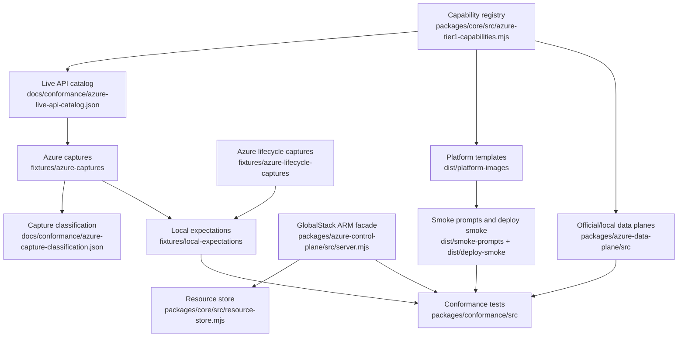

# Repository Map

Generated by: `npm run docs:map`

This file is a navigation aid. It does not replace `docs/START-HERE.md` or `docs/CONFORMANCE-MODEL.md`; those files define the project contract.

## High-Level Flow

## Core Packages

| Area | Files | Responsibility |
|---|---|---|
| Capability registry | `packages/core/src/azure-tier1-capabilities.mjs` | Tier 1/Tier 2 service scope, AWS analogues, Azure resource types, backing engines, known gaps. |
| API catalog | `packages/core/src/azure-live-api-catalog.mjs` | Candidate ARM calls and parameter variance cases for live/local conformance. |
| Hybrid coverage | `packages/core/src/hybrid-coverage.mjs` | Generated support-state model used by docs and emulator endpoints. |
| Resource store | `packages/core/src/resource-store.mjs` | In-memory Azure-shaped resource groups/resources and selected lifecycle state. |
| ARM facade | `packages/azure-control-plane/src/server.mjs` | Local Azure management-plane HTTP surface. Must fail closed for unknown or unproven behavior. |
| Provider validation | `packages/azure-control-plane/src/provider-validation.mjs` | Azure-captured validation responses normalized into local behavior. |
| Data plane adapters | `packages/azure-data-plane/src/*` | Official emulator compose generation and Azurite client checks. |
| Conformance | `packages/conformance/src/*` | Registry, capture, local expectation, lifecycle, and hybrid behavior tests. |
| Platform registry | `packages/platform-registry/src/index.mjs` | Platform definitions, solution/test file contracts, and smoke scenarios used by runners and verified bundles. |
| Bundle runtime | `packages/bundle-runtime/src/*` | Package-owned runtime helpers behind stable script entrypoints. |
| Bundle generator | `packages/bundle-generator/src/*` | Package-owned prompt, verified-bundle, and model-response generation helpers behind stable script entrypoints. |

## Generated Artifacts

| Artifact | Source | Meaning |
|---|---|---|
| `dist/platform-images/` | `npm run render` | Docker runner templates for Azure Terraform, OpenTofu, Pulumi, Ansible, Azure CLI REST, Bicep, and ARM JSON. |
| `templates/emulator/Dockerfile` | hand maintained | First-party GlobalStack Azure sidecar image. |
| `docs/hybrid/azure-hybrid-coverage.json` | `npm run hybrid:render` | Generated local support matrix. |
| `docs/conformance/azure-live-api-catalog.json` | `npm run conformance:catalog` | Candidate live Azure API calls and variance cases. |
| `docs/ARTIFACT-REGISTRY.md` | `npm run docs:artifacts` | File ownership, edit policy, source-of-truth boundaries, and generator commands. |
| `docs/conformance/azure-capture-classification.json` | `npm run conformance:classify` | Classification of real Azure captures by validation depth. |
| `fixtures/local-expectations/*.json` | `npm run conformance:expectations` and `npm run lifecycle:expectations` | Azure-derived expectations replayed against the local ARM facade. |
| `dist/smoke-prompts/` | `npm run smoke:prompts` | Prompt bundles for all platform templates. |
| `dist/deploy-smoke/` | `npm run smoke:deploy` | AI/MLOps, robotics, and GenAI smoke deployment outputs. |

## Registry Size

- Tier 1 capabilities: 15
- Tier 2 capabilities: 15
- Official/local emulator options: 13

## Package Files

- `packages/core/src/azure-differential-scenarios.mjs`
- `packages/core/src/azure-live-api-catalog.mjs`
- `packages/core/src/azure-tier1-capabilities.mjs`
- `packages/core/src/hybrid-coverage.mjs`
- `packages/core/src/resource-store.mjs`
- `packages/azure-control-plane/src/provider-validation-support.mjs`
- `packages/azure-control-plane/src/provider-validation.mjs`
- `packages/azure-control-plane/src/server-support.mjs`
- `packages/azure-control-plane/src/server.mjs`
- `packages/azure-data-plane/src/activity-log-store.mjs`
- `packages/azure-data-plane/src/aks-cluster-manager.mjs`
- `packages/azure-data-plane/src/api-management-router.mjs`
- `packages/azure-data-plane/src/app-configuration-router.mjs`
- `packages/azure-data-plane/src/azure-files-router.mjs`
- `packages/azure-data-plane/src/azurite-client.mjs`
- `packages/azure-data-plane/src/container-registry-router.mjs`
- `packages/azure-data-plane/src/cosmos-sql-router.mjs`
- `packages/azure-data-plane/src/digital-twins-router.mjs`
- `packages/azure-data-plane/src/dns-registry.mjs`
- `packages/azure-data-plane/src/edge-router.mjs`
- `packages/azure-data-plane/src/emulator-runtime.mjs`
- `packages/azure-data-plane/src/event-grid-router.mjs`
- `packages/azure-data-plane/src/event-hubs-router.mjs`
- `packages/azure-data-plane/src/functions-router.mjs`
- `packages/azure-data-plane/src/iot-hub-router.mjs`
- `packages/azure-data-plane/src/key-vault-router.mjs`
- `packages/azure-data-plane/src/kubernetes-router.mjs`
- `packages/azure-data-plane/src/log-analytics-store.mjs`
- `packages/azure-data-plane/src/metric-store.mjs`
- `packages/azure-data-plane/src/migration-plan-runner.mjs`
- `packages/azure-data-plane/src/network-model.mjs`
- `packages/azure-data-plane/src/official-emulator-compose.mjs`
- `packages/azure-data-plane/src/queue-delete-window.mjs`
- `packages/azure-data-plane/src/relational-backend-manager.mjs`
- `packages/azure-data-plane/src/search-router.mjs`
- `packages/azure-data-plane/src/service-discovery-registry.mjs`
- `packages/azure-data-plane/src/service-errors.mjs`
- `packages/azure-data-plane/src/storage-normalizer.mjs`
- `packages/azure-data-plane/src/storage-proxy.mjs`
- `packages/azure-data-plane/src/storage-router.mjs`
- `packages/azure-data-plane/src/synapse-sql-runner.mjs`
- `packages/azure-data-plane/src/waf-evaluator.mjs`
- `packages/azure-data-plane/src/workflow-runner.mjs`
- `packages/conformance/src/api-management-resource-identity.test.mjs`
- `packages/conformance/src/arm-symbolic-template-expansion.test.mjs`
- `packages/conformance/src/azure-capture-classification.mjs`
- `packages/conformance/src/azure-capture-fixtures.test.mjs`
- `packages/conformance/src/azure-derived-local-expectations.test.mjs`
- `packages/conformance/src/azure-differential-harness.test.mjs`
- `packages/conformance/src/azure-lifecycle-local-expectations.test.mjs`
- `packages/conformance/src/azure-local-lifecycle.test.mjs`
- `packages/conformance/src/azure-storage-data-plane-expectations.test.mjs`
- `packages/conformance/src/azure-storage-hoststyle.test.mjs`
- `packages/conformance/src/azure-storage-normalizer.test.mjs`
- `packages/conformance/src/cross-service-flows.test.mjs`
- `packages/conformance/src/digital-twins-router.test.mjs`
- `packages/conformance/src/docs-navigation.test.mjs`
- `packages/conformance/src/flow-study.test.mjs`
- `packages/conformance/src/globalstack-auth.test.mjs`
- `packages/conformance/src/hybrid-conformance.test.mjs`
- `packages/conformance/src/iot-hub-router.test.mjs`
- `packages/conformance/src/key-vault-router-sync.test.mjs`
- `packages/conformance/src/local-startup.test.mjs`
- `packages/conformance/src/runtime-data-plane-sync.test.mjs`
- `packages/conformance/src/runtime-security-boundaries.test.mjs`
- `packages/conformance/src/search-router.test.mjs`
- `packages/conformance/src/security-boundaries.test.mjs`
- `packages/conformance/src/storage-client-observation.test.mjs`
- `packages/conformance/src/upstream-templates.test.mjs`
- `packages/conformance/src/workflow-expression-values.test.mjs`
- `packages/platform-registry/src/index.mjs`
- `packages/bundle-runtime/src/build-platform-images.mjs`
- `packages/bundle-runtime/src/clean-runtime-artifacts.mjs`
- `packages/bundle-runtime/src/docker-globalstack-janitor.mjs`
- `packages/bundle-runtime/src/export-azure-shipment-bundle.mjs`
- `packages/bundle-runtime/src/native-deploy-bicep-cli.mjs`
- `packages/bundle-runtime/src/native-deploy-hcl-cli.mjs`
- `packages/bundle-runtime/src/smoke-bicep-runner-lifecycle.mjs`
- `packages/bundle-runtime/src/smoke-deploy-azure-usecases.mjs`
- `packages/bundle-runtime/src/smoke-platform-runner-lifecycles.mjs`
- `packages/bundle-runtime/src/stage-results.mjs`
- `packages/bundle-runtime/src/validate.mjs`
- `packages/bundle-generator/src/complex-pulumi-scenarios-wave-91046-91050.mjs`
- `packages/bundle-generator/src/complex-pulumi-scenarios-wave-91051-91055.mjs`
- `packages/bundle-generator/src/complex-pulumi-scenarios-wave-91056-91060.mjs`
- `packages/bundle-generator/src/complex-pulumi-scenarios-wave-91061-91065.mjs`
- `packages/bundle-generator/src/complex-pulumi-scenarios-wave-91066-91070.mjs`
- `packages/bundle-generator/src/complex-pulumi-scenarios-wave-91071-91075.mjs`
- `packages/bundle-generator/src/complex-pulumi-scenarios-wave-91076-91080.mjs`
- `packages/bundle-generator/src/complex-pulumi-scenarios-wave-91081-91085.mjs`
- `packages/bundle-generator/src/complex-pulumi-scenarios-wave-91086-91090.mjs`
- `packages/bundle-generator/src/complex-pulumi-scenarios-wave-91091-91095.mjs`
- `packages/bundle-generator/src/complex-pulumi-scenarios-wave-91096-91100.mjs`
- `packages/bundle-generator/src/complex-pulumi-scenarios-wave-91101-91105.mjs`
- `packages/bundle-generator/src/complex-pulumi-scenarios-wave-91106-91110.mjs`
- `packages/bundle-generator/src/complex-pulumi-scenarios-wave-91111-91115.mjs`
- `packages/bundle-generator/src/complex-pulumi-scenarios-wave-91116-91120.mjs`
- `packages/bundle-generator/src/complex-pulumi-scenarios-wave-91121-91125.mjs`
- `packages/bundle-generator/src/complex-pulumi-scenarios-wave-91126-91130.mjs`
- `packages/bundle-generator/src/complex-pulumi-scenarios-wave-91131-91135.mjs`
- `packages/bundle-generator/src/complex-pulumi-scenarios-wave-91136-91140.mjs`
- `packages/bundle-generator/src/complex-pulumi-scenarios-wave-91141-91145.mjs`
- `packages/bundle-generator/src/complex-pulumi-scenarios-wave-91146-91150.mjs`
- `packages/bundle-generator/src/complex-pulumi-scenarios-wave-91151-91155.mjs`
- `packages/bundle-generator/src/complex-pulumi-scenarios-wave-91156-91160.mjs`
- `packages/bundle-generator/src/complex-pulumi-scenarios-wave-91161-91165.mjs`
- `packages/bundle-generator/src/complex-pulumi-scenarios-wave-91166-91170.mjs`
- `packages/bundle-generator/src/complex-pulumi-scenarios-wave-91171-91175.mjs`
- `packages/bundle-generator/src/complex-pulumi-scenarios-wave-91176-91180.mjs`
- `packages/bundle-generator/src/complex-pulumi-scenarios-wave-91181-91185.mjs`
- `packages/bundle-generator/src/complex-pulumi-scenarios-wave-91186-91190.mjs`
- `packages/bundle-generator/src/complex-pulumi-scenarios-wave-91191-91195.mjs`
- `packages/bundle-generator/src/complex-pulumi-scenarios-wave-91196-91200.mjs`
- `packages/bundle-generator/src/complex-pulumi-scenarios-wave-91201-91205.mjs`
- `packages/bundle-generator/src/complex-pulumi-scenarios-wave-91206-91210.mjs`
- `packages/bundle-generator/src/complex-pulumi-scenarios-wave-91211-91215.mjs`
- `packages/bundle-generator/src/complex-pulumi-scenarios-wave-91216-91220.mjs`
- `packages/bundle-generator/src/complex-pulumi-scenarios-wave-91221-91225.mjs`
- `packages/bundle-generator/src/complex-pulumi-scenarios-wave-91226-91230.mjs`
- `packages/bundle-generator/src/complex-pulumi-scenarios-wave-91231-91235.mjs`
- `packages/bundle-generator/src/complex-pulumi-scenarios-wave-91236-91240.mjs`
- `packages/bundle-generator/src/complex-pulumi-scenarios-wave-91241-91245.mjs`
- `packages/bundle-generator/src/complex-pulumi-scenarios-wave-91246-91250.mjs`
- `packages/bundle-generator/src/generate-azure-smoke-prompts.mjs`
- `packages/bundle-generator/src/run-openai-azure-arm-json-trial.mjs`
- `packages/bundle-generator/src/run-openai-azure-complex-pulumi-bundles.mjs`
- `packages/bundle-generator/src/run-openai-azure-complex-pulumi-bundles.test.mjs`
- `packages/bundle-generator/src/run-openai-azure-platform-trials.mjs`
- `packages/bundle-generator/src/run-openai-azure-verified-bundles.mjs`
- `packages/bundle-generator/src/smoke-azure-iac-model-responses.mjs`

## Scripts

- `scripts/capture/capture-azure-aks-differential.mjs`
- `scripts/capture/capture-azure-provider-surface.mjs`
- `scripts/capture/capture-azure-storage-data-plane.mjs`
- `scripts/capture/capture-azure-storage-lifecycle.mjs`
- `scripts/capture/capture-real-azure-operation.mjs`
- `scripts/capture/capture-redaction.mjs`
- `scripts/capture/run-azure-differential.mjs`
- `scripts/conformance/check-azure-spec-drift.mjs`
- `scripts/conformance/classify-azure-captures.mjs`
- `scripts/conformance/report-provider-registration-gaps.mjs`
- `scripts/conformance/rerun-registered-shallow-azure-captures.mjs`
- `scripts/conformance/run-approval-provider-wave.mjs`
- `scripts/conformance/run-azure-api-conformance.mjs`
- `scripts/e2e/cross-service-flows.mjs`
- `scripts/e2e/e2e-azure-activity-log-audit-parity.mjs`
- `scripts/e2e/e2e-azure-aks-metadata-parity.mjs`
- `scripts/e2e/e2e-azure-api-management-parity.mjs`
- `scripts/e2e/e2e-azure-app-configuration-parity.mjs`
- `scripts/e2e/e2e-azure-container-registry-parity.mjs`
- `scripts/e2e/e2e-azure-cosmos-parity.mjs`
- `scripts/e2e/e2e-azure-database-migration-service-parity.mjs`
- `scripts/e2e/e2e-azure-dns-zones-parity.mjs`
- `scripts/e2e/e2e-azure-event-grid-parity.mjs`
- `scripts/e2e/e2e-azure-event-hubs-parity.mjs`
- `scripts/e2e/e2e-azure-files-parity.mjs`
- `scripts/e2e/e2e-azure-front-door-cdn-parity.mjs`
- `scripts/e2e/e2e-azure-functions-parity.mjs`
- `scripts/e2e/e2e-azure-identity-rbac-parity.mjs`
- `scripts/e2e/e2e-azure-key-vault-parity.mjs`
- `scripts/e2e/e2e-azure-load-balancing-parity.mjs`
- `scripts/e2e/e2e-azure-logic-workflows-parity.mjs`
- `scripts/e2e/e2e-azure-monitor-logs-parity.mjs`
- `scripts/e2e/e2e-azure-monitor-metrics-alerts-parity.mjs`
- `scripts/e2e/e2e-azure-mysql-parity.mjs`
- `scripts/e2e/e2e-azure-postgresql-parity.mjs`
- `scripts/e2e/e2e-azure-redis-parity.mjs`
- `scripts/e2e/e2e-azure-service-bus-emulator.mjs`
- `scripts/e2e/e2e-azure-service-bus-parity.mjs`
- `scripts/e2e/e2e-azure-service-discovery-parity.mjs`
- `scripts/e2e/e2e-azure-storage-hardening.mjs`
- `scripts/e2e/e2e-azure-storage-normalizer.mjs`
- `scripts/e2e/e2e-azure-storage-parity.mjs`
- `scripts/e2e/e2e-azure-storage.mjs`
- `scripts/e2e/e2e-azure-synapse-warehouse-parity.mjs`
- `scripts/e2e/e2e-azure-virtual-network-parity.mjs`
- `scripts/e2e/e2e-azure-waf-policy-parity.mjs`
- `scripts/e2e/flow-study-cases.mjs`
- `scripts/e2e/flow-study-oracles.mjs`
- `scripts/e2e/run-flow-study.mjs`
- `scripts/render/render-artifact-registry.mjs`
- `scripts/render/render-azure-99-parity-checklist.mjs`
- `scripts/render/render-azure-99-roadmap.mjs`
- `scripts/render/render-azure-live-api-catalog.mjs`
- `scripts/render/render-azure-validation-checklist.mjs`
- `scripts/render/render-hybrid-artifacts.mjs`
- `scripts/render/render-local-expectations-from-captures.mjs`
- `scripts/render/render-local-lifecycle-expectations.mjs`
- `scripts/render/render-platform-templates.mjs`
- `scripts/render/render-repo-map.mjs`
- `scripts/render/render-service-scope.mjs`
- `scripts/render/render-storage-data-plane-expectations.mjs`
- `scripts/repository/accepted-issue.cjs`
- `scripts/repository/accepted-issue.test.mjs`
- `scripts/repository/capture-redaction.test.mjs`
- `scripts/repository/check-sarif.mjs`
- `scripts/repository/check-sarif.test.mjs`
- `scripts/repository/package-check.test.mjs`
- `scripts/repository/pr-policy.mjs`
- `scripts/repository/pr-policy.test.mjs`
- `scripts/repository/spec-drift.test.mjs`
- `scripts/repository/stage-results.test.mjs`
- `scripts/repository/sync-labels.mjs`
- `scripts/runtime/build-platform-images.mjs`
- `scripts/runtime/clean-runtime-artifacts.mjs`
- `scripts/runtime/docker-globalstack-janitor.mjs`
- `scripts/runtime/local-demo.mjs`
- `scripts/runtime/native-deploy-bicep-cli.mjs`
- `scripts/runtime/native-deploy-hcl-cli.mjs`
- `scripts/runtime/smoke-bicep-runner-lifecycle.mjs`
- `scripts/runtime/smoke-deploy-azure-usecases.mjs`
- `scripts/runtime/smoke-platform-runner-lifecycles.mjs`
- `scripts/runtime/start-local.mjs`
- `scripts/runtime/test-local-services.mjs`
- `scripts/runtime/test-local.mjs`
- `scripts/runtime/validate.mjs`
- `scripts/verified/generate-azure-smoke-prompts.mjs`
- `scripts/verified/run-openai-azure-arm-json-trial.mjs`
- `scripts/verified/run-openai-azure-complex-pulumi-bundles.mjs`
- `scripts/verified/run-openai-azure-platform-trials.mjs`
- `scripts/verified/run-openai-azure-verified-bundles.mjs`
- `scripts/verified/smoke-azure-iac-model-responses.mjs`

## NPM Commands

- `npm run aks:capture:differential`
- `npm run build:images`
- `npm run capture:azure`
- `npm run check:local`
- `npm run conformance:azure`
- `npm run conformance:catalog`
- `npm run conformance:checklist`
- `npm run conformance:classify`
- `npm run conformance:expectations`
- `npm run conformance:local`
- `npm run conformance:parity`
- `npm run conformance:roadmap`
- `npm run demo`
- `npm run differential:azure`
- `npm run differential:azure:aks`
- `npm run docker:janitor`
- `npm run docker:janitor:dry-run`
- `npm run docker:prewarm`
- `npm run docs:artifacts`
- `npm run docs:map`
- `npm run docs:nav`
- `npm run docs:scope`
- `npm run docs:test`
- `npm run e2e:activity-log-audit-parity`
- `npm run e2e:aks-metadata-parity`
- `npm run e2e:api-management-parity`
- `npm run e2e:app-configuration-parity`
- `npm run e2e:azure-files-parity`
- `npm run e2e:azure-functions-parity`
- `npm run e2e:container-registry-parity`
- `npm run e2e:cosmos-parity`
- `npm run e2e:database-migration-service-parity`
- `npm run e2e:dns-zones-parity`
- `npm run e2e:event-grid-parity`
- `npm run e2e:event-hubs-parity`
- `npm run e2e:front-door-cdn-parity`
- `npm run e2e:identity-rbac-parity`
- `npm run e2e:key-vault-parity`
- `npm run e2e:load-balancing-parity`
- `npm run e2e:logic-workflows-parity`
- `npm run e2e:monitor-logs-parity`
- `npm run e2e:monitor-metrics-alerts-parity`
- `npm run e2e:mysql-parity`
- `npm run e2e:postgresql-parity`
- `npm run e2e:redis-parity`
- `npm run e2e:service-bus`
- `npm run e2e:service-bus-parity`
- `npm run e2e:service-discovery-parity`
- `npm run e2e:storage`
- `npm run e2e:storage-hardening`
- `npm run e2e:storage-normalizer`
- `npm run e2e:storage-parity`
- `npm run e2e:synapse-warehouse-parity`
- `npm run e2e:virtual-network-parity`
- `npm run e2e:waf-policy-parity`
- `npm run hybrid:emulator`
- `npm run hybrid:render`
- `npm run hybrid:test`
- `npm run lifecycle:capture:storage`
- `npm run lifecycle:expectations`
- `npm run native:bicep`
- `npm run native:opentofu`
- `npm run native:terraform`
- `npm run providers:approval-wave`
- `npm run providers:gaps`
- `npm run providers:rerun-shallow`
- `npm run providers:surface`
- `npm run render`
- `npm run repo:clean-runtime`
- `npm run repo:clean-runtime:dry-run`
- `npm run shipment:export`
- `npm run smoke`
- `npm run smoke:bicep-runner`
- `npm run smoke:deploy`
- `npm run smoke:iac-model-responses`
- `npm run smoke:platform-runners`
- `npm run smoke:prompts`
- `npm run start`
- `npm run storage:capture:data-plane`
- `npm run storage:expectations`
- `npm run test:docker`
- `npm run test:flows`
- `npm run test:gcp:unit`
- `npm run test:local`
- `npm run test:repository`
- `npm run test:services:local`
- `npm run trial:openai-arm-json`
- `npm run trial:openai-complex-pulumi-bundles`
- `npm run trial:openai-platforms`
- `npm run trial:openai-verified-bundles`
- `npm run validate`
- `npm run workspace:build`
- `npm run workspace:test`
- `npm run workspace:validate`
